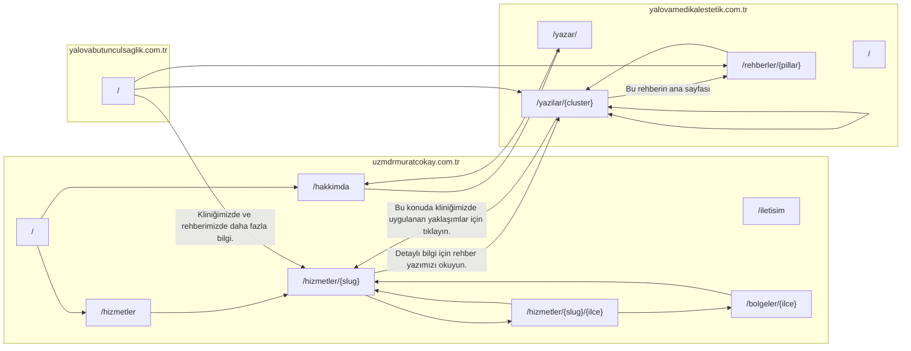

# İç bağlantı haritası

`linkifyContent(html)` her sitede `src/lib/seo/internal-links.ts` içindedir. Bir anahtar kelime yalnızca ilk geçişte bağlanır; mevcut `<a>` içi atlanır.

Doğrulama: `node scripts/validate-internal-links.mjs`

## Site içi kurallar

| Kaynak | Hedef |
| --- | --- |
| Hizmet | İlgili cluster yazı + aynı kategorideki hizmetler |
| Cluster | Pillar + kardeş cluster + ilgili hizmet |
| Pillar | Tüm cluster listesi |
| Lokasyon | Popüler hizmetler + hibrit sayfalar |
| Hibrit | Hizmet ana sayfası + bölge ana sayfası |
| Hakkımda | Blog `/yazar/` |

## CTA metinleri

- Klinik → Blog: Detaylı bilgi için rehber yazımızı okuyun.
- Blog → Klinik: Bu konuda kliniğimizde uygulanan yaklaşımlar için tıklayın.
- Niş → Klinik + Blog: Kliniğimizde ve rehberimizde daha fazla bilgi.
